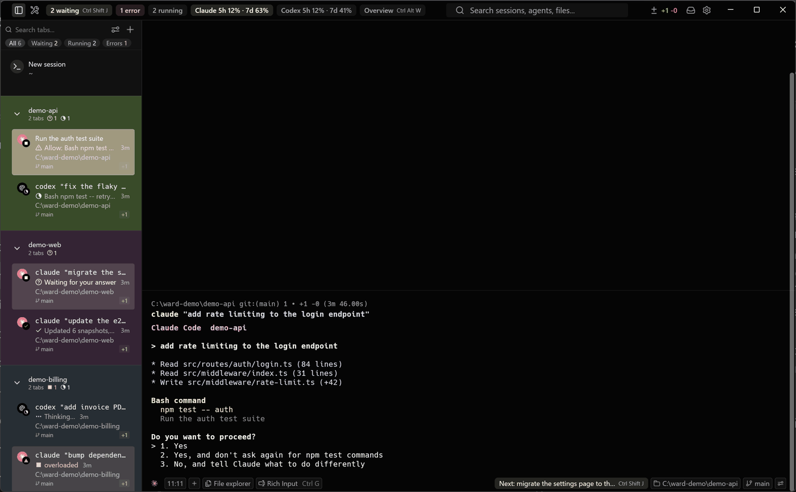
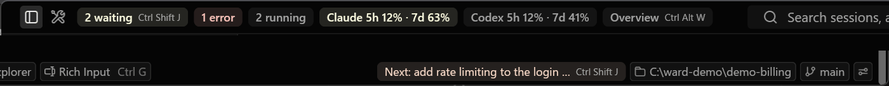
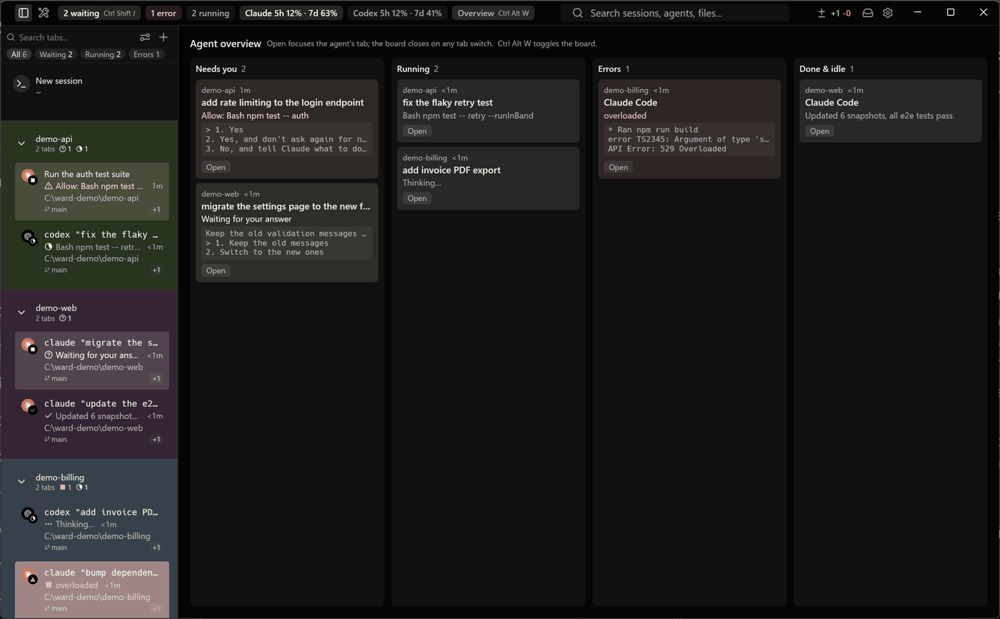
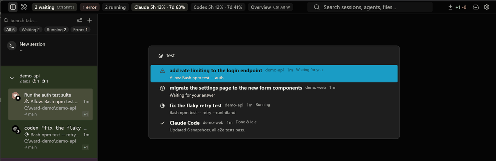
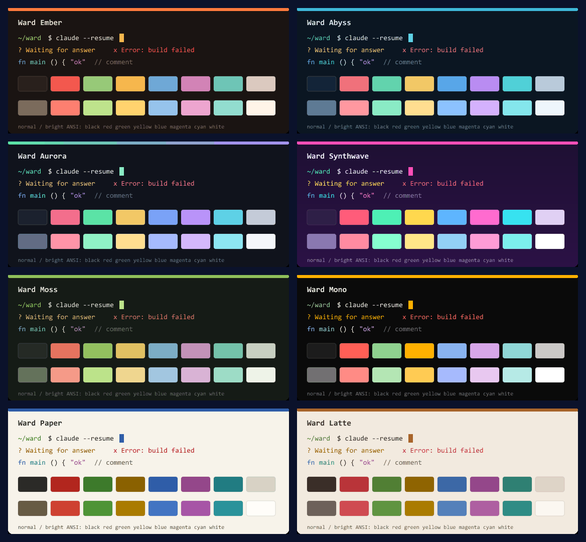
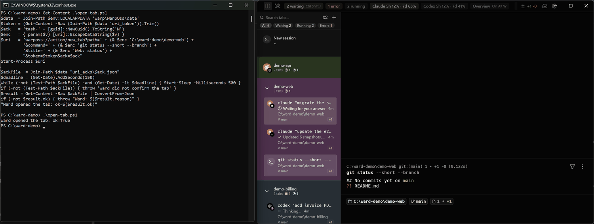
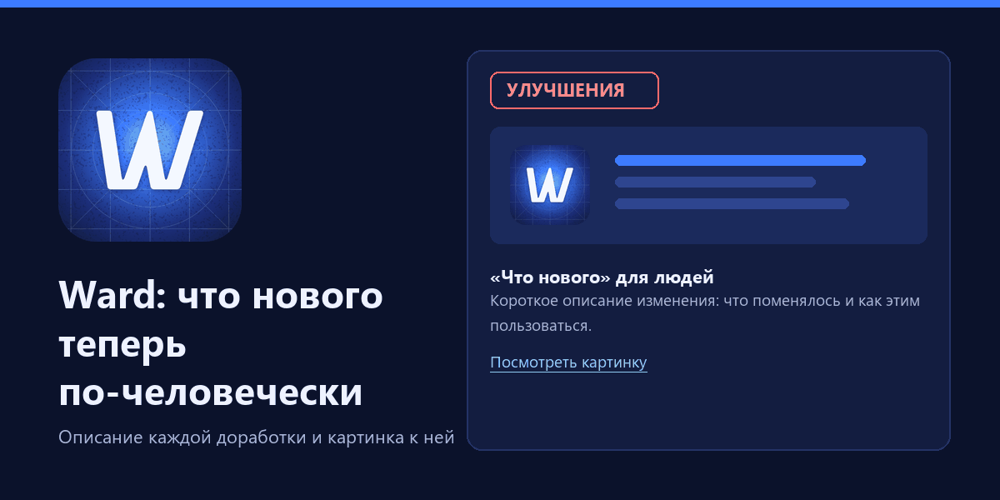
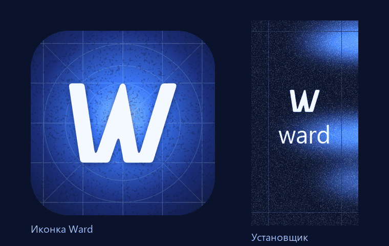

# Ward

This repository is a fork of [Warp](https://github.com/warpdotdev/warp) that builds **Ward**: the
OSS channel of Warp for Windows, tuned for working with CLI agents (Claude Code, Codex) without a
Warp account or Warp cloud features.

- Download: the latest installer is listed in
  [manifest.json](https://chimney.steep-man.ru/warp-fork/windows/stable/manifest.json); Ward
  updates itself from the same manifest.
- What Ward changes compared to Warp: [WARD.md](WARD.md).
- Building, publishing and migrating settings: [FORK.md](FORK.md).

Ward installs next to the official Warp and does not touch its data. The original Warp README
follows the gallery.

## Что умеет Ward

Подробности по каждой доработке — в [WARD.md](WARD.md), что нового в очередной версии — в окне
«Что нового» после обновления (заметки из [changes/](changes/README.md)).

### Агенты во вкладках и восстановление сессий

Вкладки с Claude Code и Codex показывают состояние агента и время в нём, ждущий ввода агент
подсвечен жёлтым. После перезапуска Ward вкладки продолжают те же сессии агентов.



### Полоса внимания и переходы

Счётчики агентов в заголовке окна и переход к ждущему: Ctrl+Shift+J — к следующему агенту,
который ждёт ввода, Ctrl+Shift+H — назад.



### Обзор агентов

Ctrl+Alt+W или кнопка в заголовке: карточки всех агентов по срочности с хвостом вывода
терминала.



### Палитра `@`

Список CLI-агентов по срочности с нечётким поиском, Enter — переход к вкладке агента.



### Chimney

Чип карточки канбана во вкладке и в футере агента, запуск агента по карточке (Ctrl+Alt+N).

### Лимиты подписок Claude и Codex

Чипы в шапке показывают, сколько использовано из 5-часового и недельного лимита, и меняют цвет
на 50% и 80%.


### Темы

Восемь своих тем в Settings → Appearance: шесть тёмных и две светлые.



### Вкладка с командой по URI

Ссылка `warposs://action/new_tab?...` открывает вкладку в нужной папке и запускает в ней
команду (только с токеном), с файлом подтверждения для скриптов.



### Автообновление и «Что нового»

Ward обновляется из своего манифеста, а после обновления показывает, что изменилось, —
описание каждой доработки с картинкой.



### Иконка и установщик

Своя синяя иконка и картинки установщика; Ward ставится рядом с Warp и не трогает его данные.




---

<a href="https://www.warp.dev">
    
</a>
&nbsp;
<p align="center">
  <a href="https://warp.dev/factories"></a>
</p>

<p align="center">
  <a href="https://www.warp.dev">Website</a>
  ·
  <a href="https://www.warp.dev/code">Code</a>
  ·
  <a href="https://www.warp.dev/agents">Agents</a>
  ·
  <a href="https://www.warp.dev/terminal">Terminal</a>
  ·
  <a href="https://www.warp.dev/drive">Drive</a>
  ·
  <a href="https://docs.warp.dev">Docs</a>
  ·
  <a href="https://www.warp.dev/blog/how-warp-works">How Warp Works</a>
</p>

> [!NOTE]
> OpenAI is the founding sponsor of the new, open-source Warp repository, and the new agentic management workflows are powered by GPT models.

<h1></h1>

## About

[Warp](https://www.warp.dev) is an agentic development environment, born out of the terminal. Use Warp's built-in coding agent, or bring your own CLI agent (Claude Code, Codex, Gemini CLI, and others).

## Installation

You can [download Warp](https://www.warp.dev/download) and [read our docs](https://docs.warp.dev/) for platform-specific instructions.

## Warp Contributions Overview Dashboard

Explore [build.warp.dev](https://build.warp.dev) to:
- Watch thousands of [Warp Factory](warp.dev/factories) agents triage issues, write specs, implement changes, and review PRs
- View top contributors and in-flight features
- Track your own issues with GitHub sign-in
- Click into active agent sessions in a web-compiled Warp terminal

## Automate development with Warp Factories

This repository is driven by [Warp Factories](https://warp.dev/factories): open, flexible infrastructure for teams to build cloud software factories of their own.

Warp Factories are defined in code and easy to deploy on any model or harness, with evals, benchmarks, and self-improvement built in. [Get early access](https://warp.dev/factories) or [book a demo](https://warp.dev/get-started) for a tailored walk-through of the platform. Eligible teams can receive up to $10,000 in free factory usage.

## Licensing

Warp's UI framework (the `warpui_core` and `warpui` crates) are licensed under the [MIT license](LICENSE-MIT).

The rest of the code in this repository is licensed under the [AGPL v3](LICENSE-AGPL).

## Open Source & Contributing

Warp's client codebase is open source and lives in this repository. We welcome community contributions and have designed a lightweight workflow to help new contributors get started. For the full contribution flow, read our [CONTRIBUTING.md](CONTRIBUTING.md) guide.

> [!TIP]
> **Chat with contributors and the Warp team** in the [`#oss-contributors`](https://warpcommunity.slack.com/archives/C0B0LM8N4DB) Slack channel — a good place for ad-hoc questions, design discussion, and pairing with maintainers. New here? [Join the Warp Slack community](https://go.warp.dev/join-preview) first, then jump into `#oss-contributors`.

### Issue to PR

Before filing, [search existing issues](https://github.com/warpdotdev/warp/issues?q=is%3Aissue+is%3Aopen+sort%3Areactions-%2B1-desc) for your bug or feature request. If nothing exists, [file an issue](https://github.com/warpdotdev/warp/issues/new/choose) using our templates. Security vulnerabilities should be reported privately as described in [CONTRIBUTING.md](CONTRIBUTING.md#reporting-security-issues).

Once filed, a Warp maintainer reviews the issue and may apply a readiness label: [`ready-to-spec`](https://github.com/warpdotdev/warp/issues?q=is%3Aissue+is%3Aopen+label%3Aready-to-spec) signals the design is open for contributors to spec out, and [`ready-to-implement`](https://github.com/warpdotdev/warp/issues?q=is%3Aissue+is%3Aopen+label%3Aready-to-implement) signals the design is settled and code PRs are welcome. Anyone can pick up a labeled issue — mention **@oss-maintainers** on an issue if you'd like it considered for a readiness label.

### Building the Repo Locally

To build and run Warp from source:

```bash
./script/bootstrap   # platform-specific setup
./script/run         # build and run Warp
./script/presubmit   # fmt, clippy, and tests
```

See [AGENTS.md](AGENTS.md) for the full engineering guide, including coding style, testing, and platform-specific notes.

## Joining the Team

Interested in joining the team? See our [open roles](https://www.warp.dev/careers).

## Support and Questions

1. See our [docs](https://docs.warp.dev/) for a comprehensive guide to Warp's features.
2. Join our [Slack Community](https://go.warp.dev/join-preview) to connect with other users and get help from the Warp team — contributors hang out in [`#oss-contributors`](https://warpcommunity.slack.com/archives/C0B0LM8N4DB).
3. Try our [Preview build](https://www.warp.dev/download-preview) to test the latest experimental features.
4. Mention **@oss-maintainers** on any issue to escalate to the team — for example, if you encounter problems with the automated agents.

## Code of Conduct

We ask everyone to be respectful and empathetic. Warp follows the [Code of Conduct](CODE_OF_CONDUCT.md). To report violations, email warp-coc at warp.dev.

## Open Source Dependencies

We'd like to call out a few of the [open source dependencies](https://docs.warp.dev/help/licenses) that have helped Warp to get off the ground:

- [Tokio](https://github.com/tokio-rs/tokio)
- [NuShell](https://github.com/nushell/nushell)
- [Fig Completion Specs](https://github.com/withfig/autocomplete)
- [Warp Server Framework](https://github.com/seanmonstar/warp)
- [Alacritty](https://github.com/alacritty/alacritty)
- [Hyper HTTP library](https://github.com/hyperium/hyper)
- [FontKit](https://github.com/servo/font-kit)
- [Core-foundation](https://github.com/servo/core-foundation-rs)
- [Smol](https://github.com/smol-rs/smol)
